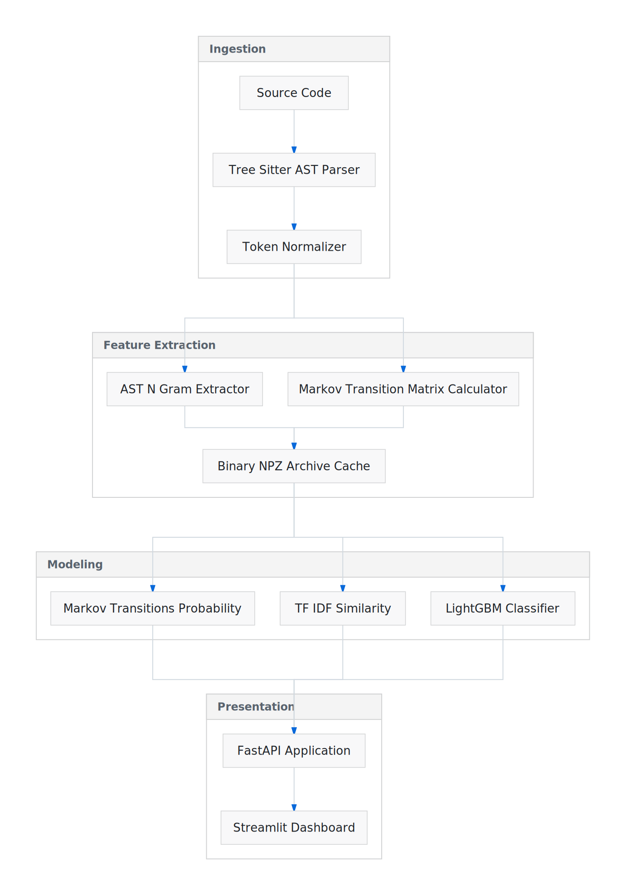

# TC3002B Reto: Source Code Plagiarism and AI Detection

This repository contains the software for the capstone challenge in course TC3002B.570.

The system detects source code plagiarism and classifies code generated by AI.

## Team

* Fernando Daniel Monroy Monroy
* Diego De la Vega Saishio
* Do Kyu Han

## Architecture

The pipeline processes source code through 5 sequential stages.
The system generates concrete syntax trees, computes token transition matrices, and runs classifier inference.

## Structure

The repository organizes modules by technical responsibility:

todo: architecture

## Quickstart

If you run the application locally, follow these steps:

todo: steps
