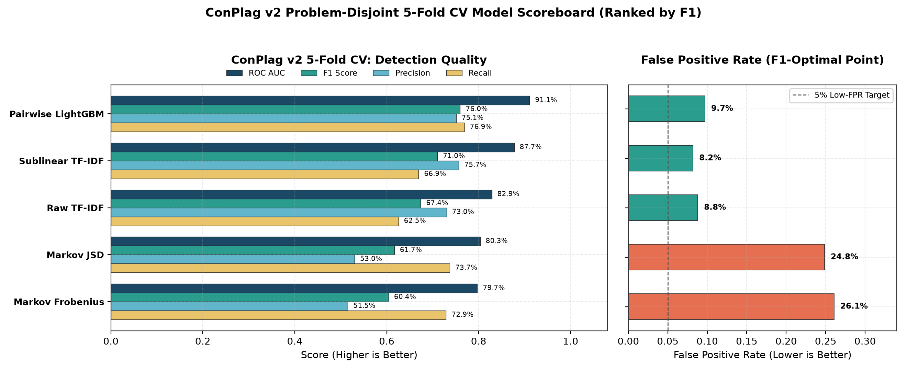
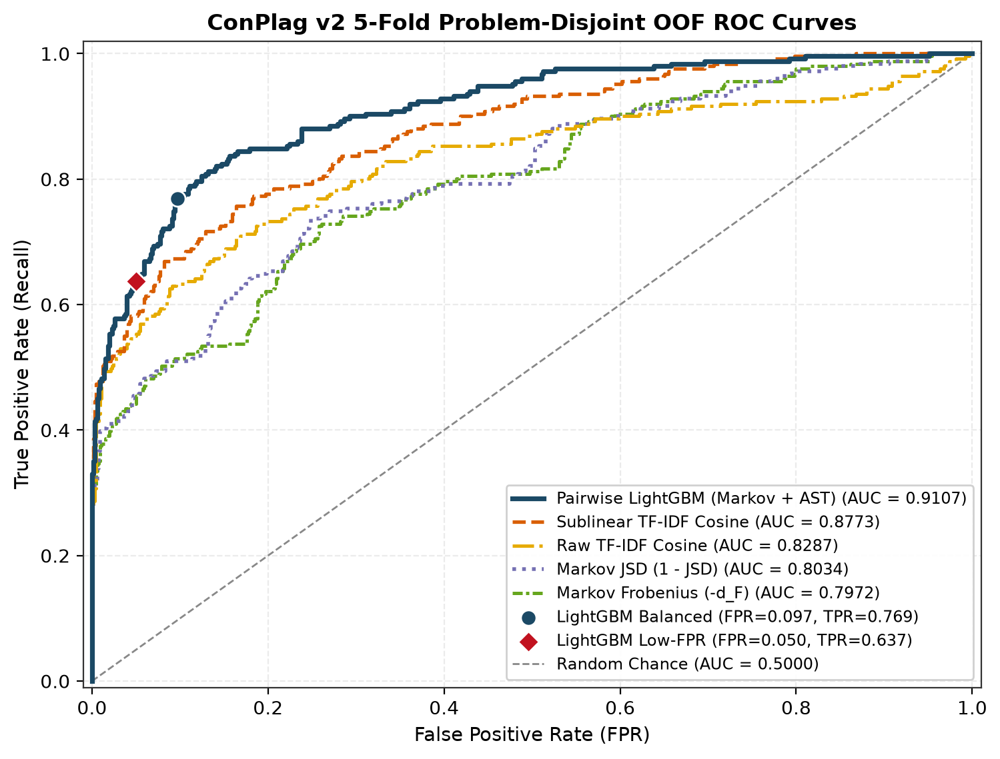
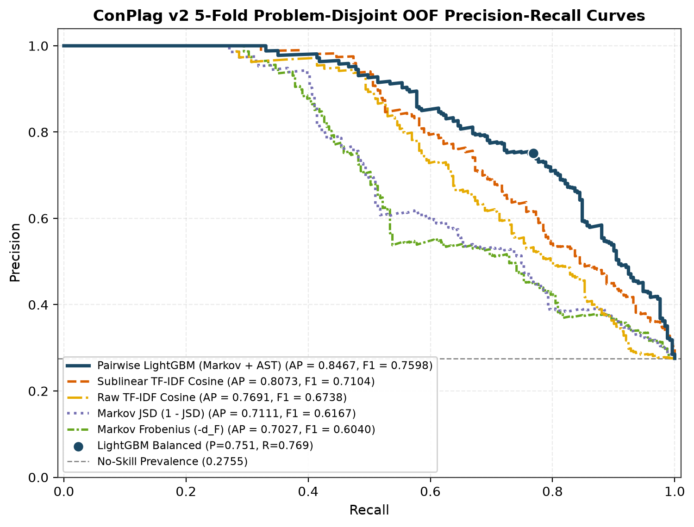
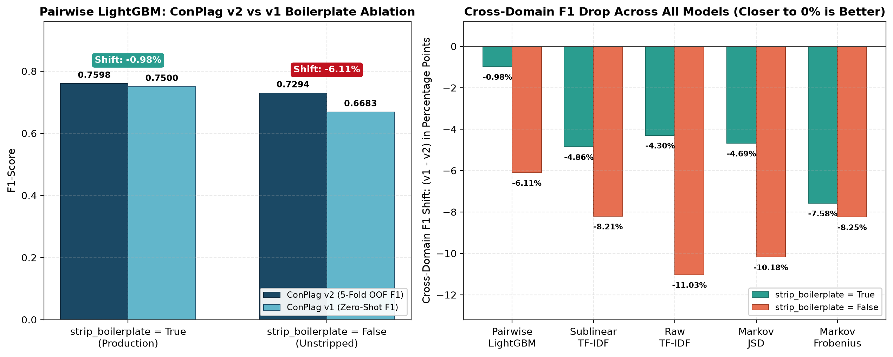
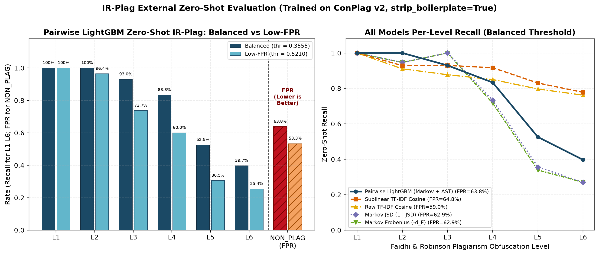
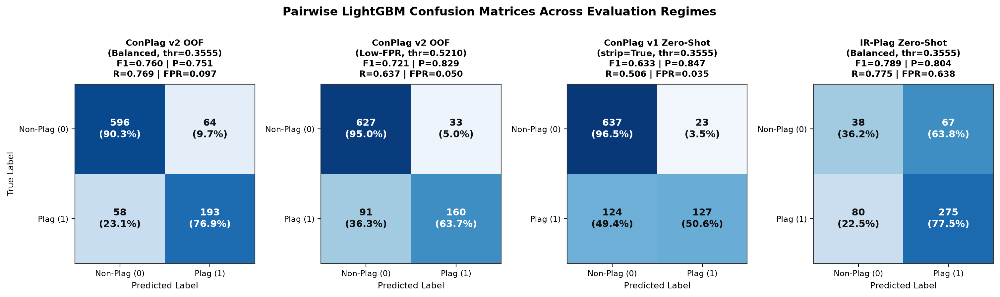

# Evaluation Results

This report compares our calibrated Pairwise LightGBM model against 4 mathematical baselines on Java source code plagiarism benchmarks.

## Quick Glossary

Models tested:

* **Pairwise LightGBM**: Trained gradient boosted classifier combining symmetric 12 state AST Markov features, JSD, Frobenius distance, and perplexity differences.
* **Sublinear TF IDF**: Character n gram text similarity using log scaled term frequency (`1 + log(tf)`).
* **Raw TF IDF**: Character n gram text similarity using unscaled term counts.
* **Markov JSD**: Unsupervised similarity `1 - JSD(P_A, P_B)` between AST transition probability matrices.
* **Markov Frobenius**: Unsupervised negative Euclidean distance `-||P_A - P_B||_F` between AST transition probability matrices.

Metrics reported:

* **F1**: Harmonic mean of Precision and Recall (higher is better).
* **Precision**: Share of flagged pairs that are truly plagiarized (higher means fewer false accusations).
* **Recall**: Share of truly plagiarized pairs that the model catches (higher means fewer missed cases).
* **ROC AUC**: Ranking quality across all thresholds from `0.5` (random) to `1.0` (perfect).
* **FPR (False Positive Rate)**: Share of clean pairs mistakenly flagged as plagiarized (lower is better).
* **OOF (Out of Fold)**: Predictions made on unseen problem folds during 5 fold problem disjoint cross validation.

Datasets used:

* **ConPlag v2**: 911 Java contest pairs across 21 problems with template boilerplate removed (primary training and CV dataset).
* **ConPlag v1**: The same 911 pairs with raw competitive programming templates intact (boilerplate robustness test).
* **IR Plag**: 460 held out introductory Java pairs spanning obfuscation levels `L1` (comments and whitespace) through `L6` (heavy loop and logic rewrites), plus `NON_PLAG` clean pairs.

## 1. Overall Model Comparison (ConPlag v2)

**Takeaway:** Pairwise LightGBM beats all 4 baselines on ConPlag v2 problem disjoint 5 fold CV (`76.0%` F1 and `91.1%` ROC AUC), cutting false positives by more than half compared to standalone Markov distance metrics (`9.7%` vs `24.9%` and `26.1%` FPR).

| Model | F1 | Precision | Recall | ROC AUC | FPR | Macro F1 (mean +/- std) | Macro AUC (mean +/- std) |
| :--- | ---: | ---: | ---: | ---: | ---: | ---: | ---: |
| Pairwise LightGBM | 76.0% | 75.1% | 76.9% | 91.1% | 9.7% | 72.0% +/- 10.6% | 92.3% +/- 4.7% |
| Sublinear TF IDF | 71.0% | 75.7% | 66.9% | 87.7% | 8.2% | 68.6% +/- 8.8% | 88.1% +/- 4.7% |
| Raw TF IDF | 67.4% | 73.0% | 62.6% | 82.9% | 8.8% | 66.6% +/- 9.1% | 83.5% +/- 7.8% |
| Markov JSD | 61.7% | 53.0% | 73.7% | 80.3% | 24.9% | 55.4% +/- 7.8% | 80.9% +/- 5.8% |
| Markov Frobenius | 60.4% | 51.6% | 72.9% | 79.7% | 26.1% | 53.7% +/- 5.8% | 80.3% +/- 5.5% |

## 2. Boilerplate Removal And Domain Shift (ConPlag v2 to v1)

**Takeaway:** Removing imports and competitive I/O boilerplate cuts Pairwise LightGBM's cross domain F1 drop on raw ConPlag v1 files from `-6.11%` down to `-0.98%` while keeping false positives at `1.4%`.

| Model | Boilerplate Handling | ConPlag v2 F1 | ConPlag v1 F1 | F1 Shift (v1 - v2) | ConPlag v1 ROC AUC | ConPlag v1 FPR |
| :--- | :--- | ---: | ---: | ---: | ---: | ---: |
| Pairwise LightGBM | Stripped | 76.0% | 75.0% | -0.98% | 82.2% | 1.4% |
| Sublinear TF IDF | Stripped | 71.0% | 66.2% | -4.86% | 84.9% | 3.6% |
| Raw TF IDF | Stripped | 67.4% | 63.1% | -4.30% | 80.2% | 4.4% |
| Markov JSD | Stripped | 61.7% | 57.0% | -4.69% | 74.0% | 18.6% |
| Markov Frobenius | Stripped | 60.4% | 52.8% | -7.58% | 73.1% | 25.3% |
| Pairwise LightGBM | Unstripped | 72.9% | 66.8% | -6.11% | 80.5% | 3.0% |
| Sublinear TF IDF | Unstripped | 68.1% | 59.9% | -8.21% | 79.0% | 14.4% |
| Raw TF IDF | Unstripped | 65.4% | 54.4% | -11.03% | 76.3% | 24.1% |
| Markov JSD | Unstripped | 60.1% | 49.9% | -10.18% | 69.5% | 31.2% |
| Markov Frobenius | Unstripped | 59.4% | 51.2% | -8.25% | 71.0% | 34.2% |

## 3. Zero Shot Obfuscation Benchmark (IR Plag)

**Takeaway:** Trained only on ConPlag v2, Pairwise LightGBM catches `100%` of `L1` and `L2` copies, `93.0%` of `L3`, and `83.3%` of `L4`, while dropping on heavy structural rewrites (`L5` `52.5%`, `L6` `39.7%`). All 5 models show high zero shot FPR (`53.3%` to `64.8%`) on short introductory Java exercises because independent student solutions to tiny prompts share nearly identical control flow.

### Overall IR Plag Zero Shot Metrics

| Model | Operating Mode | Precision | Recall | F1 | ROC AUC | FPR |
| :--- | :--- | ---: | ---: | ---: | ---: | ---: |
| Pairwise LightGBM | Balanced | 80.4% | 77.5% | 78.9% | 63.2% | 63.8% |
| Pairwise LightGBM | Low FPR | 80.1% | 63.7% | 71.0% | 63.2% | 53.3% |
| Sublinear TF IDF | Balanced | 82.4% | 89.6% | 85.8% | 69.4% | 64.8% |
| Sublinear TF IDF | Low FPR | 83.2% | 84.8% | 84.0% | 69.4% | 58.1% |
| Raw TF IDF | Balanced | 83.2% | 86.5% | 84.8% | 72.2% | 59.0% |
| Raw TF IDF | Low FPR | 83.2% | 82.5% | 82.9% | 72.2% | 56.2% |
| Markov JSD | Balanced | 79.2% | 71.0% | 74.9% | 64.4% | 62.9% |
| Markov JSD | Low FPR | 83.2% | 54.4% | 65.8% | 64.4% | 37.1% |
| Markov Frobenius | Balanced | 79.1% | 70.4% | 74.5% | 62.8% | 62.9% |
| Markov Frobenius | Low FPR | 86.4% | 51.8% | 64.8% | 62.8% | 27.6% |

### Per Level Recall (`L1` to `L6`) And Clean Pair FPR

| Model | Operating Mode | L1 | L2 | L3 | L4 | L5 | L6 | Clean FPR |
| :--- | :--- | ---: | ---: | ---: | ---: | ---: | ---: | ---: |
| Pairwise LightGBM | Balanced | 100.0% | 100.0% | 93.0% | 83.3% | 52.5% | 39.7% | 63.8% |
| Pairwise LightGBM | Low FPR | 100.0% | 96.4% | 73.7% | 60.0% | 30.5% | 25.4% | 53.3% |
| Sublinear TF IDF | Balanced | 100.0% | 92.9% | 93.0% | 91.7% | 83.1% | 77.8% | 64.8% |
| Sublinear TF IDF | Low FPR | 96.7% | 87.5% | 86.0% | 86.7% | 76.3% | 76.2% | 58.1% |
| Raw TF IDF | Balanced | 100.0% | 91.1% | 87.7% | 85.0% | 79.7% | 76.2% | 59.0% |
| Raw TF IDF | Low FPR | 100.0% | 87.5% | 86.0% | 80.0% | 72.9% | 69.8% | 56.2% |
| Markov JSD | Balanced | 100.0% | 94.6% | 100.0% | 73.3% | 35.6% | 27.0% | 62.9% |
| Markov JSD | Low FPR | 100.0% | 91.1% | 89.5% | 41.7% | 6.8% | 3.2% | 37.1% |
| Markov Frobenius | Balanced | 100.0% | 94.6% | 100.0% | 71.7% | 33.9% | 27.0% | 62.9% |
| Markov Frobenius | Low FPR | 100.0% | 87.5% | 80.7% | 40.0% | 5.1% | 3.2% | 27.6% |
